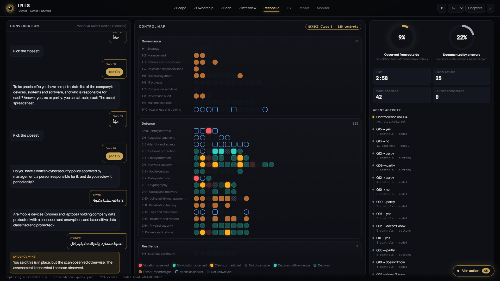

# Iris

Sees it. Fixes it. Proves it.

Iris is an AI agent that runs a Saudi small business's NCA cybersecurity assessment on its own, in Arabic.
It scans the company from outside, interviews the owner about the rest, checks the answers against the
evidence, fixes what it safely can and scans again to prove each fix. Risky changes go to IT as a ticket.
Then it drafts the missing documents and keeps watching. It runs on an open model on an 8 GB GPU, and company
data stays on machines the owner chose.

Built for the HUMAIN Future AI Builders Hackathon, Challenge 3: Autonomous Enterprise.

Replay a real run: https://compliance-officer-replay.vercel.app
Video: _link added at submission_



## Why

NCA's controls for private companies ([NCNICC-1:2025](https://nca.gov.sa/ar/news/ncnicc/), issued 28 Dec 2025)
cover every firm with 6 to 249 staff:
[169,511 firms](https://www.monshaat.gov.sa/sites/default/files/2024-02/SME%20Monitor%20-%20Q4%202023%20EN_0.pdf).
The whole Kingdom has just over
[22,000 cybersecurity specialists](https://nca.gov.sa/en/studies-and-reports/reports/report-on-key-economic-indicators-in-the-cybersecurity-sector-in-the-kingdom-2026/),
and a breach in Saudi Arabia costs
[SAR 27 million on average and takes 226 days to find](https://mea.newsroom.ibm.com/CODB-Saudi-Arabia-Findings).
Today a firm can hire a consultant, fill in a self-assessment that owners overstate (Chidukwani et al.,
Computers & Security, 2026), or run a scanner that sees 18 of the 204 control rows and fixes nothing.

## How it works

1. Asks the staff count and works out which controls apply.
2. Refuses to scan until a DNS record proves the domain is the owner's.
3. Scans with 32 detectors: email spoofing, exposed databases and remote access, TLS and certificates, web
   headers, outdated software, exposed panels and files, DNS.
4. Asks up to 16 plain-Arabic questions about what a scan can't see, and follows up on vague replies.
5. Flags answers the scan contradicts. The evidence wins.
6. Applies the fixes the owner approves and scans again. A gap closes only when the new scan confirms it.
7. Writes IT tickets for what it won't change itself, drafts the missing documents and plans the next 90 days.
8. Keeps scanning. A problem that comes back is fixed again if the owner approved that fix before; anything
   new needs approval.

The owner proves the domain, answers questions and approves changes. Iris does the rest.

## Where the AI is

The model reads each reply (Saudi dialect, English, Arabizi, typos) as yes, no, partly or don't know, and
decides whether to follow up. At every step, code builds a menu of allowed actions and the model picks one; a
pick outside the menu is refused. Mapping, scoring, contradictions, which fixes are allowed and whether a fix
worked are plain code, and text from scanned sites never reaches the model. We tested four open models,
including HUMAIN's ALLaM-7B, and chose qwen3:8b.


Next: a vision model that checks uploaded proof, a small agent inside the network, and HUMAIN ONE with a
larger ALLaM.

## Results

Held-out sets, frozen before tuning and run once. Full numbers in [docs/EVALUATION.md](docs/EVALUATION.md).

| Test | Result |
|---|---|
| 6 unseen live lab companies | 23/23 planted problems found, 20/20 fixable ones removed and proven, 0 false "fixed" claims |
| 60 sessions on 20 unseen firms | 60/60 completed, violations found at 0.96 precision and 0.97 recall, 43/43 visible overstatements caught |
| Monitoring, 20 unseen firms | 58/58 changes caught, 31/31 approved fixes re-applied and proven, 0 false alarms |
| Injection, 30 payloads, 4 models | raw text hijacked every model; behind the typed boundary, 0/30 for all four |
| Robustness, 7 conditions | stops when ownership is lost, finishes as a questionnaire when the model is down |
| Same 60 sessions, 3 models (qwen3, gpt-oss, ALLaM) | 180/180 completed, 0 forbidden actions, 43/43 visible overstatements caught by each |
| 20 real owner replies | 19/20 read correctly |

Without the scan, no violations are found. Without the interview, 10 of 120 rows are settled instead of 104.
Without the action gate, the model took 14 forbidden actions. Without the second scan, it made 5 false
"fixed" claims.

## Run it

```bash
uv sync --python 3.12
uv run officer demo     # a full session on a synthetic firm, no GPU, about a minute
uv run officer serve    # the interface at http://127.0.0.1:8000
```

With Ollama and `qwen3:8b` pulled: `uv run officer run --sim --seed 7 --persona overstating --model ollama:qwen3:8b`.
Tests: `uv run pytest -m "not integration and not lab"`. Check a recorded run:
`uv run officer audit-verify runs/<file>.jsonl`.

## Repository

- `src/officer/` the agent
- `src/p2c/` the scanning and mapping engine (see NOTICE)
- `lab/` the fictional company's test lab
- `site/` the interface and replay page
- `evals/` evaluations and frozen test splits
- `docs/` design decisions, threat model, evaluation, iteration log

## Licence

Apache-2.0, see [NOTICE](NOTICE). NCA control text is not reproduced here; identifiers refer to the official
publications at nca.gov.sa. Built by AlJasser AlGhamdi.
