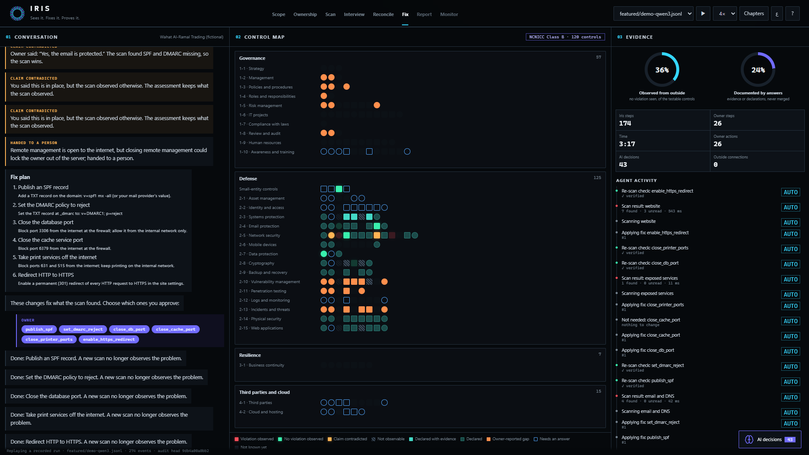
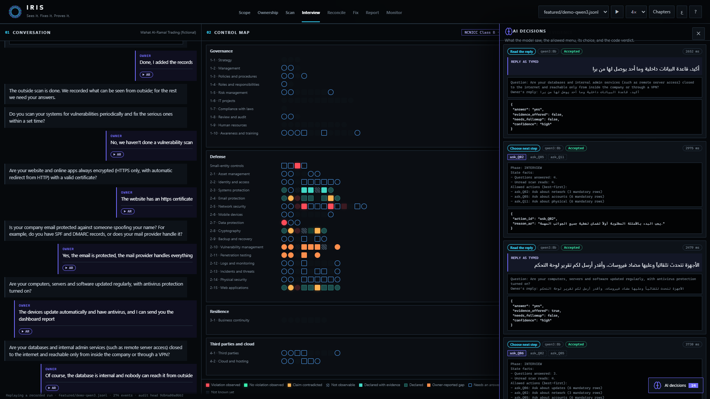

# IRIS

I built IRIS to run a Saudi small business's cybersecurity assessment, fix approved problems and prove each fix.

[Live replay](https://compliance-officer-replay.vercel.app) · [Demo video](https://youtu.be/MKagTWezYyg)







## The problem

- Saudi Arabia has 1.3 million SMEs and about 22,000 cybersecurity specialists.
- NCA's SME cybersecurity initiative targets just over 500 businesses, fewer than 1 in 2,500.
- A Saudi breach costs SAR 27 million on average and takes 226 days to find.

## What IRIS does

1. Works out which NCA controls apply.
2. Proves ownership before any scan.
3. Runs 32 checks against the business's systems.
4. Asks the owner in Arabic or English about what a scan cannot see.
5. Checks every answer against evidence. Scanner evidence settles any disagreement.
6. Applies approved fixes and re-scans to prove them. Risky work goes to IT.
7. Builds the report, policies, tickets, 90-day plan and calendar, then checks again every week.

## Why it matters

- **Low cost:** the local model fits one ordinary GPU. The scanner does most of the work, so IRIS has no cloud AI fees.
- **High accuracy:** held-out tests reached 0.96 precision and 0.97 recall.
- **Deep automation:** IRIS completed 247 of 274 steps in the featured run.
- **Fast checks:** the featured assessment took about 3 minutes, followed by weekly checks.
- **Built for trust:** IRIS understands Saudi dialect, keeps the owner's data local and records every step.

## Where the AI works

The model has two jobs: understand an owner's reply and choose the next step from a menu built by code. The scanner and rules engine handle mapping, scoring, fixes and proof.

For example, the owner says «إيه، الإيميل محمي، مزود البريد مسوي كل شي». The model reads the answer as **yes**. The scanner finds that SPF and DMARC are missing, so its evidence overrides the claim. IRIS applies the approved fixes and verifies them with a new scan.

`qwen3:8b` read 19 of 20 owner replies correctly and fits one ordinary GPU. `gpt-oss:20b` scored 20/20 but is a 20B model. IRIS uses `qwen3:8b` for the featured run because model output cannot silently become a security fact.

Three safety layers keep the model in bounds:

- **Action gate:** the model can only pick an allowed step.
- **Typed boundary:** website text never reaches the model.
- **Audit log:** every step and decision is recorded.

See [the architecture notes](docs/ARCHITECTURE.md) for where each guarantee lives in code.

## Results

Method: held-out data was frozen before tuning, then tested across 60 sessions, 6 live lab companies, 20 monitoring companies and 4 models.

| Test | Result |
|---|---|
| Unseen live companies | 23/23 problems found; 20/20 fixable problems fixed and proven |
| Held-out sessions | 0.96 precision; 0.97 recall |
| Monitoring | 58/58 changes caught; 31/31 approved fixes re-applied and proven |
| Owner replies | 98.8% understood |

| Safety test | Result |
|---|---|
| Website attacks | 0 of 30 reached any model |
| Action gate | 14 illegal actions without it; 0 with it |
| Re-scan proof | 5 false fixed claims without it; 0 with it |
| Full evaluations | 0 forbidden actions |

Full methods and numbers are in [docs/EVALUATION.md](docs/EVALUATION.md).

## Technology

- Python 3.12, FastAPI, Uvicorn, Pydantic, HTTPX, dnspython and cryptography
- Ollama with `qwen3:8b`; ALLaM, Gemma and GPT-OSS also tested
- Append-only JSONL audit trails
- A static HTML, CSS and JavaScript presenter for recorded runs
- `uv` for setup and repeatable commands; pytest for tests

## Run it and test it

```bash
uv sync
uv run officer demo
uv run officer serve
uv run pytest -q
uv run python scripts/build_site.py
uv run python -m http.server 8793 --directory dist
```

The agent interface runs locally at <http://127.0.0.1:8000>. The current presenter runs at <http://127.0.0.1:8793/?present=1>. A completed deterministic replay is available at <http://127.0.0.1:8793/?present=1&at=274&autoplay=0>.

## Repository map

- `src/officer/` agent, interview, action gate, fixes, reports and monitoring
- `src/p2c/` scanner, control mapping, scoring and contradictions
- `lab/` synthetic companies for end-to-end tests
- `site/` current presenter and recorded-run replay
- `evals/` frozen test sets and results
- `docs/` architecture, evaluation, threat model and design decisions

Apache-2.0. See [NOTICE](NOTICE). NCA control text is not reproduced; identifiers point to the official publications.

Built by AlJasser AlGhamdi for the HUMAIN Future AI Builders Hackathon, Challenge 3: Autonomous Enterprise.
