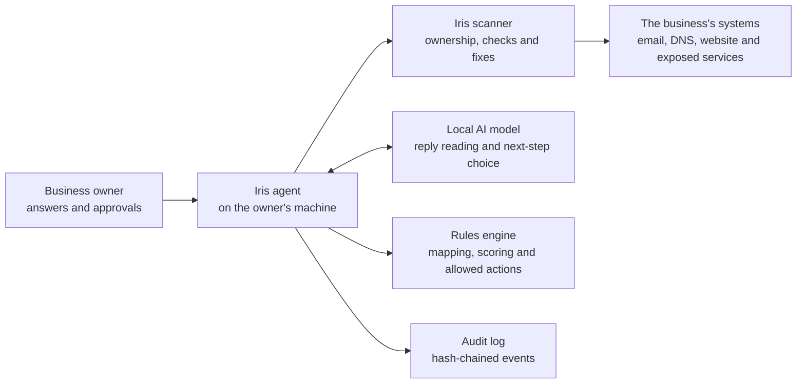

# Architecture

The agent, model, scoring engine and audit trail run on the owner's machine. The Iris scanner returns typed facts. Website text is handled as scanner data and never becomes model input. The model proposes, code checks and scanner evidence settles the security fact.

## The loop

1. **Scope.** Staff count decides which controls apply, and a change re-scopes the assessment.
2. **Ownership.** The owner proves control of the domain. Iris refuses to scan until the proof passes.
3. **Scan.** Checks cover DNS and email, web, TLS and exposed services. An unread result never counts as clean.
4. **Interview.** Iris asks about controls a scan cannot see and follows up on unclear answers.
5. **Reconcile.** The engine compares declarations with findings. When they disagree, the finding wins.
6. **Fix.** Iris proposes allowlisted fixes, applies the owner's approved choices and re-scans. Risky work goes to IT.
7. **Hand over.** Every open problem Iris will not change becomes a ticket with exact steps.
8. **Document and plan.** Iris drafts missing documents, a ranked 30/60/90-day plan and a calendar. Drafts never change a score.
9. **Report.** The bilingual report includes every control's state and source, tickets, drafts, plan and audit head.
10. **Monitor.** Iris checks again each week. It re-applies only fixes approved and proven earlier; new work needs approval.

## Where each guarantee lives

| Guarantee | Code |
|---|---|
| Legal actions only | `session.py` builds each menu; `brain.choose_action` refuses anything outside it |
| Typed boundary | `contract.py` validates scanner replies; unknown detector IDs are rejected |
| Evidence precedence and two scores | `assessment.py` calls the engine's `merge_assessments` and `compute_dual_score` |
| Contradictions | The engine's `detect_contradictions`; question areas follow claim relations in `questions.py` |
| Verification | `session._apply_group` re-scans; a fix is verified only after the new scan |
| Data boundary | `sovereignty.py` wraps the engine's egress guard; blocked attempts are counted on screen |
| Audit | `events.py` maintains the hash chain; `officer audit-verify` checks it |
| Monitoring trust | `watch._respond` re-applies only fixes approved and verified earlier |
| Drafts do not score | `documents.py` writes text; declarations come only from the owner's answers |

## The model's two jobs

Every model call goes through `llm.Provider` and has a narrow schema:

1. Read an owner's reply as yes, no, partly or do not know, with a short reason.
2. Pick one next step from the action menu built by code.

Each call is an event containing the input, allowed menu, output and validator verdict. The interface shows the trace in its AI panel. A scripted provider powers repeatable tests and the offline demo, while Ollama runs the featured local model.

The owner-reply evaluation measures interpretation, not security accuracy. `qwen3:8b` read 19 of 20 replies correctly and fits one ordinary GPU. `gpt-oss:20b` scored 20/20 but is a 20B model. Iris uses `qwen3:8b` for the featured run because scanner evidence still overrides a model interpretation.
