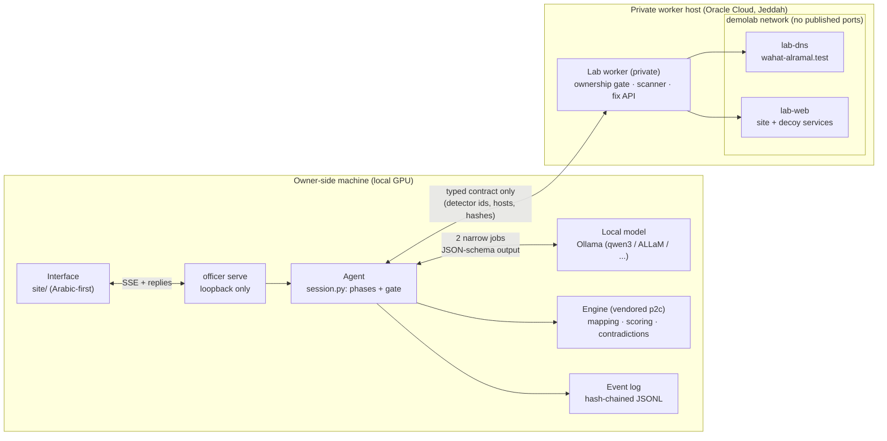

# Architecture

## The loop

1. Scope. The staff count decides which controls apply: NCNICC Class B by default, Class A above 249 staff,
   full ECC-2:2024 for suppliers to government. A change mid-session re-scopes and re-prioritises.
2. Ownership. The worker issues DNS TXT challenges, the owner publishes them and the worker verifies them.
   Until then no scan is on the menu, and the worker refuses one (403) regardless.
3. Scan. Four groups: DNS and email, web, TLS, exposed services. Each result is typed: detector ids found and
   detector ids that could not be read. Unread never counts as clean.
4. Interview. Up to 16 questions. A priority rule puts mandatory rows first and favours areas where the scan
   saw problems or could not see; the model may reorder the top three.
5. Reconcile. The engine flags declarations that a finding contradicts, and the finding wins.
6. Fix. Iris proposes fixes from an allowlist and the owner approves them. It applies a scan group's fixes
   together and confirms them with one re-scan, retrying an unconfirmed fix once before escalating it. It never
   closes remote management (SSH) on its own.
7. Hand over. Every open problem Iris will not change itself becomes a ticket with exact steps
   (`workplan.tickets`): risky changes it escalated, fixes a re-scan could not confirm, and findings outside
   its allowlist (an exposed login panel, outdated software, a sensitive file).
8. Document and plan. For each gap the owner admitted, Iris drafts a document with the company's details and
   blanks for what only the owner knows (`documents.py`), plus a ranked 30/60/90-day plan and a calendar file
   of recurring tasks (`workplan.py`). Drafts never change a score.
9. Report. Bilingual: every row's state and source, the plan, the tickets, the drafts and the audit head.
10. Monitor. Each round re-scans every group under the same ownership proof. Iris re-fixes a returning problem
    without asking only if the owner approved that fix and a re-scan verified it; those go first. Anything
    left needs approval, risky changes go to a person, and a lost ownership record stops
    monitoring (`watch.py`).

## Where each guarantee lives

| Guarantee | Code |
|---|---|
| Legal actions only | `session.py` builds each menu; `brain.choose_action` refuses anything outside it |
| Typed boundary | `contract.py` validates every worker reply; unknown detector ids are rejected |
| Evidence precedence, two scores | `assessment.py` on the engine's `merge_assessments`, `compute_dual_score` |
| Contradictions | engine `detect_contradictions`; question areas follow its claim relation (`questions.py`) |
| Verification | `session._apply_group` re-scans; `fix_result` is only `verified=true` after the scan |
| Sovereignty | `sovereignty.py` wraps the engine's egress guard; blocked attempts are counted on screen |
| Audit | `events.py` hash chain; `officer audit-verify` |
| Monitoring trust | `watch._respond`: re-apply only fixes approved and verified earlier; the model picks from that menu |
| Drafts do not score | `documents.py` writes text only; declarations come from the owner's answers alone |

## Models

Every model call goes through `llm.Provider`: Ollama by default, a scripted provider for tests and the offline
demo, and a down provider for robustness tests. Prompts stay under 1.5K tokens because ALLaM-7B's 4K context
is the tightest. Each call is an event with its input, the menu offered, the output and the validator's
verdict, shown in the interface's AI-in-action panel.
